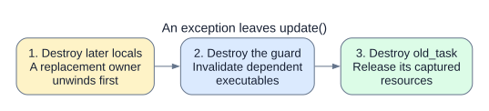

# Section CUDA graphs: contracts and reference

Use this page when implementing a graph-compatible task or diagnosing a graph set.
The [visual guide](section-cuda-graphs.md) explains the execution and planning algorithms.

The snippets are interface excerpts or method bodies, not complete task definitions.
Core types below belong to `holoflow::core`; `CUDA_CHECK` is the project's CUDA error-check helper.

## Configuration

```cpp
holoflow::runtime::Compiler::Config config;
config.max_section_cuda_graphs = 4096;
config.log_dir = "logs";
holoflow::runtime::Compiler compiler(registry, config);
```

| Setting | Contract |
| --- | --- |
| `max_section_cuda_graphs` | Default 4,096 per section; 0 disables section graphs. Applies after sequence pruning and unordered expansion. |
| `HOLOFLOW_MAX_SECTION_CUDA_GRAPHS` | Holovibes' compilation-time override. |
| `log_dir` | Enables publication of `section_cuda_graphs.json`. |
| Budget | Graph count, not bytes. No automatic queue-capacity or window changes. |

## Recording interface

```cpp
// ISyncTask interface; opt-in defaults to false.
virtual bool supports_cuda_graph() const noexcept;
virtual void record_cuda_graph(CudaGraphCtx &ctx);
```

For a task whose GPU submission is isolated in an `enqueue` helper:

```cpp
bool supports_cuda_graph() const noexcept override { return true; }

void record_cuda_graph(CudaGraphCtx &ctx) override {
  enqueue(ctx.inputs, ctx.outputs, ctx.stream);
}
```

Here, `enqueue` submits this task's kernels or library operations. Ordinary `execute()`
can share that helper, but recording must omit its host-side execution logic.

| Recording contract | Requirement |
| --- | --- |
| Inputs | `ctx.inputs` and `ctx.outputs` are this task's port views, bound to private recording storage. |
| Stream and graph | `ctx.stream` is already capturing into the shared `ctx.graph`; both handles are borrowed. |
| Precondition | Plans, modules, and workspaces are initialized before recording. |
| Guarantee | With fixed bindings/configuration, replay works without calling the host task each iteration. |
| State | Do not retain views, mutate live storage, advance host state, consume events, or acquire/publish/release buffers. |
| GPU operations | GPU-maintained state and conditional nodes are allowed. Do not launch cached executables, start nested capture, or embed child graphs. |
| Eligibility | Every synchronous task opts in; synchronous owned-output publication and per-iteration host decisions are unsupported. |
| Lifetime | Captured resources remain valid until dependent executables are destroyed. |

For an explicit node, preserve the current dependency edge data and update the capture frontier.
This example adds an empty node; a conditional node uses the same composition steps.

```cpp
std::vector<cudaGraphNode_t> nodes;
std::vector<cudaGraphEdgeData> edges;
ctx.dependencies(nodes, edges);

cudaGraphNodeParams params{};
params.type = cudaGraphNodeTypeEmpty;
cudaGraphNode_t node;
CUDA_CHECK(cudaGraphAddNode(&node, ctx.graph, nodes.data(),
                           edges.data(), nodes.size(), &params));
ctx.set_dependencies(std::span{&node, size_t{1}});
```

The next captured operation depends on `node`. Adding it to the graph alone does not update
the stream frontier. Child-graph nodes are rejected recursively, including inside conditional bodies.

## Pointer domains and sequences

Owners provide stable storage-base addresses and may additionally describe their order.
These interfaces are on `ITask`; only owned ports may be queried.

```cpp
virtual std::optional<std::vector<std::byte *>>
owned_input_pointers(size_t port) const;
virtual std::optional<std::vector<std::byte *>>
owned_output_pointers(size_t port) const;
virtual std::optional<PointerSequence>
owned_input_pointer_sequence(size_t port) const;
virtual std::optional<PointerSequence>
owned_output_pointer_sequence(size_t port) const;

struct PointerSequence {
  std::vector<size_t> prefix;
  std::vector<size_t> cycle;
};
```

For a four-buffer output ring with a single owned output port:

```cpp
// Factory infer(): one count entry per output port.
result.owned_output_pointer_counts = {size_t{4}};

// Owner methods. buffers_ holds stable base addresses; next_ is a domain index.
std::optional<std::vector<std::byte *>>
owned_output_pointers(size_t port) const override {
  if (port != 0) throw std::out_of_range("output port");
  return std::vector<std::byte *>{buffers_.begin(), buffers_.end()};
}

std::optional<PointerSequence>
owned_output_pointer_sequence(size_t port) const override {
  if (port != 0) throw std::out_of_range("output port");
  PointerSequence order;
  for (size_t i = 0; i < buffers_.size(); ++i)
    order.cycle.push_back((next_ + i) % buffers_.size());
  return order;
}
```

If `next_ == 2`, the cycle is `[2,3,0,1]`. A startup sequence can instead use
`PointerSequence{{4,4}, {0,1,2,3}}` with a fifth, scratch-buffer domain entry.

| Domain/sequence contract | Requirement |
| --- | --- |
| Addresses | Complete, unique, non-null storage-base addresses **before** `TDesc::offset`; count equals the declaration. Stable for the compiled lifetime. |
| Counts | Supplied count vectors match the number of ports. Empty vectors or `nullopt` entries mean unknown. |
| Queries | Read-only while stopped; never acquire buffers or advance queues. Null addresses between ownership phases are not domain members. |
| Sequence | Indices into that port's address vector. Prefix may be empty; cycle is nonempty; repeated indices are valid. |
| Origin | Step zero is the next successful use. Retries do not advance; referenced phases advance once per complete section iteration. |
| Unknown metadata | Unknown counts or missing enumeration cause fallback. Missing sequence means Cartesian expansion. |
| Invalid metadata | Malformed counts, duplicate/null addresses, empty cycles, or out-of-range indices are validation errors. |

[Horizon planning](section-cuda-graphs.md#find-the-reachable-tuples) combines sequences only within
one section. Above the 1,000,000-step horizon budget, it conservatively expands all domains.

## Factory updates and reuse

```cpp
// ITaskFactory: default policy is AlwaysInvalidate.
virtual ExecutionUpdatePolicy execution_update_policy() const noexcept;
```

| Policy | Obligation |
| --- | --- |
| `AlwaysInvalidate` | Compiler invalidates dependent executables before `update()`, even if the task is reused unchanged. |
| `ExplicitInvalidation` | Factory invalidates before incompatible captured changes and guards exception paths. Compatible captures may survive. |

Example bodies inside a synchronous factory; `compatible` checks captured operations/resources:

```cpp
ExecutionUpdatePolicy
execution_update_policy() const noexcept override {
  return ExecutionUpdatePolicy::ExplicitInvalidation;
}

std::unique_ptr<ISyncTask>
update(std::unique_ptr<ISyncTask> old_task,
       std::span<const TDesc> inputs,
       const nlohmann::json &settings,
       const SyncCreateCtx &ctx) const override {
  // Construct before update locals.
  ExecutionUpdateGuard guard(ctx.execution_invalidation);
  (void)infer(inputs, settings); // May throw.
  if (compatible(old_task.get(), inputs, settings))
    return old_task;

  // Invalidate before changing or releasing captured resources.
  ctx.invalidate_execution();
  return create(inputs, settings, ctx);
}
```

| Update contract | Requirement |
| --- | --- |
| Invalidation | Idempotent and non-throwing; callback must not throw. |
| Context handle | Borrowed for this update only. Null during creation or standalone calls makes `invalidate_execution()` a no-op. Never retain it. |
| Exception guard | Invalidates during exception unwinding; normal return does nothing. |
| Ownership | Keep captured resources in the `old_task` parameter until all fallible work succeeds. A local replacement owner can unwind before the guard. |
| Compiler checks | Task order, boundary membership, wiring, descriptors/offsets, storage IDs/aliases, and stream identity must also match. No storage-ID remapping. |

[](../../assets/images/holoflow-section-cuda-update-order.svg)

*Destruction order on exception. The guard protects resources still owned by the parameter,
not resources already transferred into a later local.*

| Change | Capture compatibility |
| --- | --- |
| Device data changes; captured arguments/allocations stay fixed | Can preserve graphs: compatible Fresnel distance, Flatfield sigma, or CausalSlidingAverage reset. |
| Captured arguments change | Invalidate: PCA settings can change captured GEMM arguments. |
| Compatible allocation transfer | Can preserve graphs: BatchQueue transfers its buffer, but cursors reset and startup replans. |
| Distance-only ShackHartmannSlopes update | Preserves captures in both modes; pixel-to-slope factors do not depend on propagation distance. |
| Allocation or incompatible descriptor changes | Invalidate dependent graphs. DualReaderBatchQueue retains ring/scratch only for matching byte sizes and memory location. |

Compatible queue updates reset history/cursors as appropriate; preserving memory does not preserve
the previous reachable phases. Generated-kernel identities and specialization changes would also
need compatibility checks if fusion is introduced.

## Scheduler contracts

```cpp
// compiler_output must outlive scheduler.
scheduler.request_pause();
scheduler.wait();  // Workers joined; CUDA streams drained.
scheduler.start(); // Same scheduler: continue retained checkpoints.

// Before recompilation, also destroy the stopped scheduler.
scheduler.request_stop();
scheduler.wait();
```

| Operation | Guarantee or requirement |
| --- | --- |
| First start | Consumes the generation/cap/section-bound inspection once. Tasks and bindings must stay unchanged until then. |
| Pause/resume | Retains acquired ports, pops, successful compute, submissions, pushes, and partial releases. No preparation; fallback stays disabled. |
| Stop, EOF, unsolicited cancellation | Aborts the iteration; a later start reinspects phases and refreshes variants. |
| Task returns `Cancelled` | Retryable with the same views; no committed consumption, publication, or GPU work. Return `Ok` after successful submission even if pause races. |
| Lookup miss | Disables section graphs before submission; ordinary execution is safe. |
| Capture/instantiation failure | Partial sets are cleared; fallback requires successful stream recovery. An unusable CUDA context propagates failure. |
| Launch failure | Never retry through ordinary execution: GPU work might already have been submitted. |
| Destruction/recompile | Stop/wait first; destroy dependent executables before captured resources. Destroying a paused scheduler releases held outputs. Camera buffering still limits future frames. |

## Diagnostics

```cpp
const auto report = scheduler.section_graph_diagnostics(); // JSON array by section.
const auto timing = scheduler.section_graph_metrics();     // Host submission metrics.
```

An abbreviated, illustrative snapshot for a section with 14 prepared variants:

```json
[
  {
    "section": "example",
    "status": "ready",
    "enabled": true,
    "raw_cartesian_count": 30,
    "pruned_count": 14,
    "variants": 14,
    "reused": 0,
    "created": 14,
    "discarded": 0,
    "launches": 100,
    "ordinary_iterations": 0,
    "pointer_misses": 0,
    "tuple_misses": 0
  }
]
```

| Report field | Meaning |
| --- | --- |
| `status` | `planned`: inspected, not instantiated; `ready`: prepared; `fallback`: ordinary execution; `error`: invalid contract or unrecoverable failure. |
| `raw_cartesian_count`, `pruned_count`, `variants` | Unpruned product, required tuples, installed executables. Read associated status fields; unknown/skipped values are not zero. |
| `domains`, `blockers`, `failure_stage`, `recording_task` | Ownership/alias/count/sequence information and failure context. Enumeration may be skipped to avoid huge domains. |
| `reused`, `created`, `discarded` | Counts for the latest preparation pass. |
| `inspection_reused`, `compiled_inspection_ms` | First-start plan reuse; current `inspection_ms` is zero when reused. |
| `launches`, `ordinary_iterations`, miss counters, `refresh_count` | Cumulative across starts/resumes within a compilation; reset on recompilation. |
| Compilation fields | `compilation_generation`, `carried_from_previous_compilation`, `compilation_invalidation_reason` explain carryover. |
| Timing | Graph metrics measure host submission, not GPU execution. Node counts/throughput remain available; graph intervals set `individual_timing_available=false`. |

Snapshots remain available after fallback. File publication copies state synchronously, then formats
and writes on a background worker. New pending reports coalesce by destination; shutdown drains writes,
and I/O failures warn without stopping later writes. Use the internal writer's flush in tests before
reading/deleting reports. Normal logs summarize passes; addresses are trace-only.

## Reference validation

The portable fixture uses deterministic endpoints, 64-frame windows, and a final queue capacity of
32. With a 4,096 cap, its planned counts are:

| Section | Cartesian | Pruned |
| --- | ---: | ---: |
| Conversion → Reshape | 792 | 264 |
| PCA → Filter2D | 21 | 21 |
| Fresnel → Mean → FFTShift → Flatfield → Mean | 4,032 | 504 |
| PctClip → Conversion | 2,376 | 792 |
| Total | 7,221 | 1,581 |

Regular tests use smaller dimensions and a 128 cap. Run the full-size comparison separately:

```powershell
ctest --test-dir build/msvc-multi -C Release -R 'SectionGraphReference.PerformanceFullReference' -V
```

This checks ordinary-versus-graph output equivalence and reports compile/start times, throughput,
and allocated device memory. Memory includes task/library allocations; its difference only approximates
graph overhead.

Sources: [task interfaces](https://github.com/DigitalHolography/Holoflow/blob/ab343f7/src/holoflow/include/holoflow/core/tasks.hh),
[queue declarations](https://github.com/DigitalHolography/Holoflow/blob/ab343f7/src/holotask/src/asyncs/batch_queue.cc),
[guarded update](https://github.com/DigitalHolography/Holoflow/blob/ab343f7/src/holotask/src/syncs/wrap2pi.cu),
and [reference fixture](https://github.com/DigitalHolography/Holoflow/blob/ab343f7/test/holotask/fixtures/section_cuda_graph_reference.json).

Regenerate the SVGs with `python tools/generate_section_cuda_graph_figures.py`.
