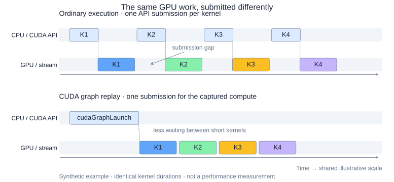
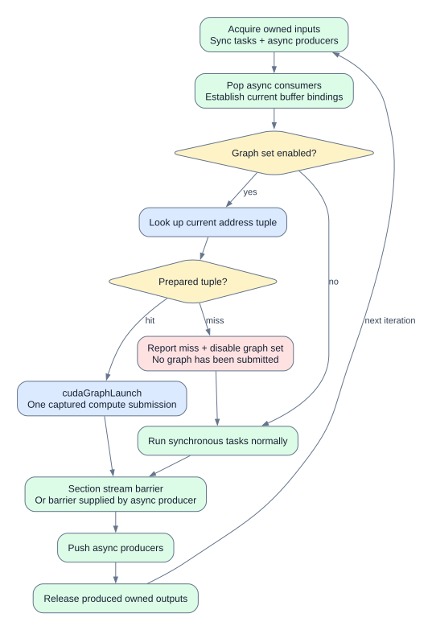
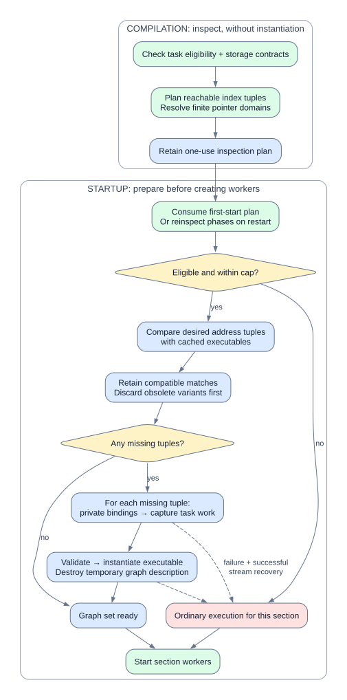
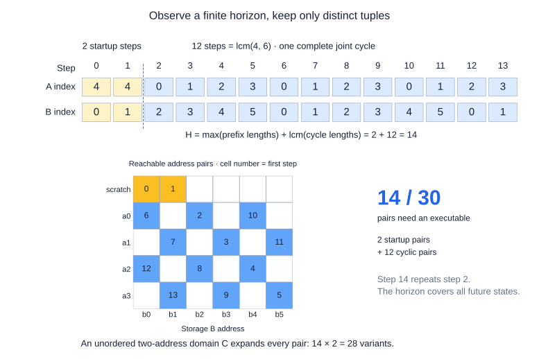
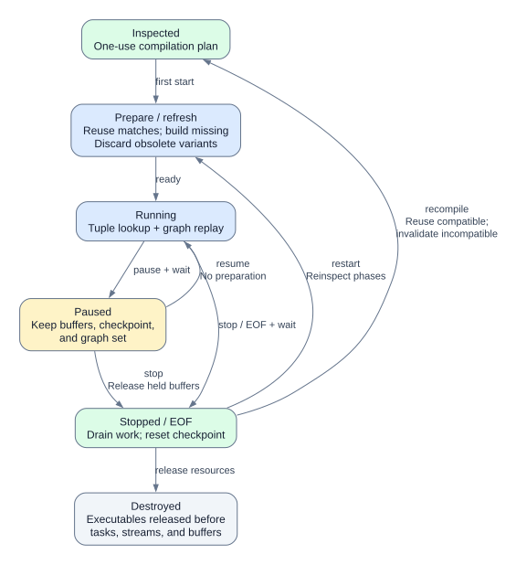

# Section CUDA graphs

A section can submit its synchronous GPU work with one `cudaGraphLaunch`, instead of
calling every task on the host for every iteration. The GPU still runs the same kernels;
Holoflow changes how their work is submitted.

This page follows the execution path, then explains the finite graph set behind that single
launch. The [contracts and reference](section-cuda-graphs-reference.md) cover configuration,
task interfaces, updates, diagnostics, and validation.

## Why CUDA graphs?

A CUDA graph describes GPU operations and the dependencies between them. A node can represent
a kernel, a copy, or another supported operation; an edge says which work must precede it.
CUDA **instantiates** that description into an executable that can be launched repeatedly.
Capture records operations into a graph rather than executing a frame.

For short kernels, the CPU can spend enough time preparing and submitting each operation
that the GPU finishes one kernel before the next is ready. Graphs move much of that setup into
instantiation and submit the recorded workflow together.
See [NVIDIA's CUDA Graphs guide](https://docs.nvidia.com/cuda/cuda-programming-guide/04-special-topics/cuda-graphs.html).

*Same kernels and kernel durations in both panels. The spaces between GPU blocks are submission
gaps. This is an illustrative timeline, not an Nsight measurement.*

!!! tip "One submission for the captured compute"
    One `cudaGraphLaunch` replaces the section's repeated compute submissions. Short kernels
    can run more tightly packed, with less host launch overhead and fewer gaps between them.

Graphs do not fuse kernels or make their arithmetic faster. Dependencies and GPU scheduling
still apply, and a workload already dominated by long-running kernels may see little benefit.
Acquisition, asynchronous queue operations, barriers, and release remain outside the section
graph. An asynchronous producer may also launch GPU work, such as SlidingAverage's producer kernel.

## One section iteration

Each section has its own worker thread. It first establishes the current buffer bindings, then
chooses how to run the synchronous compute.

*Blue nodes describe the graph path. The surrounding host operations are shared by both paths.*

The lookup key is the ordered tuple of current `Storage::ptr` addresses. A hit selects one
prepared executable. A miss disables graph execution for that section and runs the ordinary
task loop **before any graph submission**. Unknown individual addresses are pointer misses;
known addresses in an unprepared combination are tuple misses. Other sections can keep using graphs.

A graph launch failure does not retry the same iteration through ordinary execution: that could
duplicate GPU work. A cooperative pause saves progress at operation boundaries, including acquired
ports, completed pops, submitted graphs, pushes, and releases. Resuming the same scheduler
continues that checkpoint without repeating successful operations.

## Construct the graph set before execution

Graph preparation happens while execution is stopped. Every synchronous task must support recording,
and every referenced storage must have a finite, known pointer domain. Unsupported tasks, missing
domains, or too many variants select ordinary execution for the whole section.

*Compilation plans; startup prepares. Capture and instantiation happen only for missing variants.*

Compilation inspects the sections and retains a one-use plan. The first start consumes it without
repeating inspection. For each eligible section, preparation compares the desired address tuples
with the cached ones: retain matches, destroy obsolete variants, then construct missing variants.
An unchanged enabled set can be retained in place, even if enumeration order changed.

For each missing tuple, the runtime creates **private recording bindings**, captures every
synchronous task's GPU work in topological order, validates the graph, and instantiates an executable.
Recording must not acquire buffers, publish storage, consume events, or advance task state.
The temporary graph description is destroyed; the executable stays in the cache.

Workers start only after preparation. There is no capture on the first frame and no per-launch
parameter update. Capture or instantiation failure clears partial executable sets and selects
ordinary execution if stream recovery succeeds; an unusable CUDA context propagates an error.
Malformed pointer contracts fail validation rather than silently selecting fallback.

## Why cache several graphs?

### Bindings rotate, kernel arguments stay concrete

A queue can expose a different address each iteration. A captured kernel argument still contains
the address recorded during construction; updating the host-side `Storage::ptr` does not change
that argument.

Passing a pointer-to-pointer would require kernels to accept a device-side address table and
dereference it. Holoflow does not control every task's or CUDA library's kernel interface, so it
cannot impose that convention. It records one executable for each needed combination of concrete
addresses and chooses the matching executable at runtime.

A **pointer domain** is the finite list of addresses a storage may expose. A **tuple** chooses
one address from each domain, in storage-ID order. Only storage used by synchronous tasks contributes
a dimension. Tensor aliases share their storage's dimension; compiler-owned storage has one address.
The cache borrows these allocations and owns its CUDA executable handles and lookup metadata.

### Find the reachable tuples

The Cartesian product assumes that every combination is possible. Queue order often makes that
an overestimate. Owners can declare a `PointerSequence`: a finite `prefix`, followed by a repeating
`cycle`. Its entries are **indices into the pointer domain**, not addresses or port numbers.

Consider two storages:

| Storage | Domain | Prefix | Cycle |
| --- | --- | --- | --- |
| A | `a0, a1, a2, a3, scratch` | `[4, 4]` | `[0, 1, 2, 3]` |
| B | `b0, b1, b2, b3, b4, b5` | `[]` | `[0, 1, 2, 3, 4, 5]` |

The next successful section iteration is step zero. Both sequences advance together; failed
readiness polls do not advance the logical step. These declarations describe bindings without
running tasks or dequeuing buffers.

*Orange cells are startup tuples; blue cells belong to the repeating part. White cells are not
reachable from these starting phases. Step 14 repeats step 2.*

After the longest prefix finishes, every sequence is periodic. Their combined state repeats after
the least common multiple of their cycle lengths, even when the cycles begin at different steps.
Thus a sufficient finite **horizon** is:

\[
H = \max_i |\mathrm{prefix}_i| + \operatorname{lcm}_i |\mathrm{cycle}_i|
\]

Here, `H = 2 + lcm(4, 6) = 14`. Simulating steps `0..13` finds two startup pairs and twelve
cyclic pairs: **14 variants instead of 5 × 6 = 30**. A horizon counts simulated steps; deduplication
can produce fewer variants when indices or tuples repeat.

The planner performs four operations:

1. Compute the longest prefix and joint period with checked arithmetic.
2. Simulate sequence-controlled domains over the horizon and deduplicate index tuples.
3. Expand every domain without a sequence as an independent Cartesian dimension.
4. Resolve domain indices to actual addresses for executable construction and cache lookup.

For an additional unordered storage C with two addresses, each of the 14 pairs needs both C choices:
**28 variants**. A missing sequence means conservative expansion, not exclusion.

If the horizon exceeds the **1,000,000-step planning budget**, all domains use Cartesian expansion.
The graph cap is separate: it limits the final variant count, including unordered expansion.
The default is **4,096 per section**; zero disables graphs. The planner rejects excessive counts
before allocating a large graph set. Counts add across sections and do not directly measure memory.

Current queue phases matter. Restarting from a different phase can change the reachable tuple set.
The planner combines sequences only within one section, never between independently progressing
producer and consumer sections.

## Lifetime, reuse, and invalidation

*Pause preserves the checkpoint and graph set. Restart and recompilation can change which variants are needed.*

| Event | What happens to the graph set? |
| --- | --- |
| First start | Consume the compilation inspection and eagerly prepare variants. |
| Pause → resume | Retain buffers, checkpoints, and executables; skip graph preparation. A section that fell back stays in fallback. |
| Stop or EOF → restart | Inspect current phases again; reuse matching variants, discard obsolete ones, and construct missing ones. |
| Compatible recompilation | Carry over compatible executables, then plan from updated task state. |
| Captured operation/resource changes | Invalidate dependent executables before changing or releasing captured resources. |
| Cache destruction | Destroy executable handles before tasks, streams, and buffers. |

Reuse requires compatible section structure, bindings, descriptors, streams, and captured operations
and resources. Keeping the same task object alone is insufficient. Conversely, device-data updates
can preserve an executable when its captured arguments and allocations remain valid.

The default factory update policy invalidates before `update()`. An audited factory can use explicit
invalidation to preserve compatible executables, but must invalidate before incompatible changes
and protect exception paths. Details and examples are in the
[factory update reference](section-cuda-graphs-reference.md#factory-updates-and-reuse).

## Read the reports

`Scheduler::section_graph_diagnostics()` exposes planned and prepared counts, reuse/create/discard
counts, fallback reasons, and launch/miss counters. Host graph-submission timing is not GPU execution
duration. See the [diagnostics](section-cuda-graphs-reference.md#diagnostics) and
[reference validation](section-cuda-graphs-reference.md#reference-validation) for measurement guidance.

### NVTX ranges

Each section worker emits one range named after the section per iteration, with nested phases:
`Acquire inputs`, `Async pop`, `Compute`, `Wait`, `Async push`, and `Release outputs`.
Phases span their nodes and readiness polling; phases without work are omitted. Ordinary execution
keeps the `sync execute: name (kind)`, `async pop: name (kind)`, and `async push: name (kind)` task
ranges. Graph execution instead nests `CUDA graph launch` inside `Compute`; its CPU duration measures
host submission, not GPU execution. Variant selection and fallback also belong to `Compute`.

`Wait` covers the scheduler's stream synchronization. When an asynchronous producer supplies the
barrier, its synchronization remains inside `Async push`. Stop/EOF draining and output release appear
under a separate `Section cleanup` range. Pausing closes the current iteration segment on its worker;
resuming opens a new segment around the retained checkpoint, without spanning the paused interval.

Graph recording retains its existing task annotations. In Nsight Systems, graph granularity gives
a lower-overhead view of complete GPU graphs; node granularity exposes their individual operations.
Capture-time NVTX projection requires profiling graph construction, or the profiler's precapture
mode when construction precedes collection. CPU task ranges are not executed again during replay.
